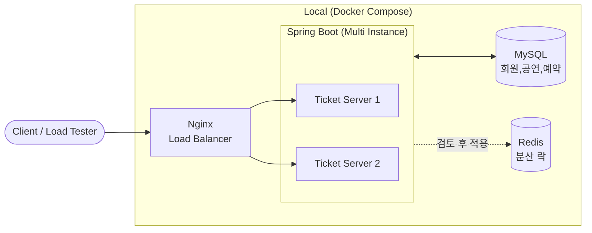

# ticket-reservation-api

Java와 Spring Boot 기반의 티켓 예매 API 서버 프로젝트입니다.
공연별 한정 수량 티켓을 예약·결제·취소하는 과정에서 발생하는 동시성 문제를 다루며, 분산 환경에서도 예약 상태와 판매 수량의 정합성을 보장하는 것에 집중합니다.

## 목표

- **동시성 제어**: 예약 신청이 동시에 몰려도 총 판매 수량을 초과해 예약되지 않도록 보장
- **데이터 정합성**: 예약·결제·취소·만료 과정에서 예약 상태와 판매 수량의 일관성을 유지하고, 중복 복구를 방지
- **분산 환경 대응**: DB 기반 동시성 제어를 우선 구현하고, 여러 애플리케이션 인스턴스 환경에서 Redis 분산 락 적용 필요성을 검토·검증
- **성능 측정 및 개선**: 부하 테스트로 처리량과 응답 시간을 측정하고, 동시성 제어 방식별 성능을 비교


## 전체적인 구조



### 구성 요소

- **Spring Boot:** 회원, 공연, 예약 API 및 애플리케이션 내부의 Mock 결제 처리를 담당합니다.
- **MySQL:** 회원, 공연, 예약 데이터를 저장합니다.
- **Redis:** 분산 락을 통한 동시성 제어에 사용하며, DB 기반 방식과 성능을 비교합니다.
- **Nginx:** 다중 인스턴스 환경에서 요청을 분산합니다.
- **Docker Compose:** 로컬에서 Spring Boot 다중 인스턴스와 MySQL, Redis, Nginx를 함께 실행할 수 있도록 환경을 구성합니다.

## 주요 기능

API Base path: `/api/v1`

| 구분 | 기능 | 설명                                                 |
|---|---|----------------------------------------------------|
| 회원 | 이메일 중복 확인 | 이메일 형식 검증 및 정규화(공백 제거, 대문자 → 소문자 변환) 후 사용 가능 여부 반환 |
| | 회원 가입 | 이메일·비밀번호로 가입, 비밀번호 해시 저장, 동시 가입 시 중복 계정 방지         |
| | 로그인 | 인증 정보(토큰) 발급, 권한 정보 포함                             |
| 공연 | 공연 등록 (관리자) | 공연 정보, 판매 기간, 판매 수량, 가격 등록 및 유효성 검증                |
| | 공연 조회 | 전체 또는 예약 가능한 공연 목록 조회, 상세 조회                       |
| | 공연 수정 (관리자) | 예약 존재 여부에 따른 변경 제한, 예약 수량 이상으로만 총 판매 수량 조정         |
| 예약 | 예약 신청 | 판매 기간·잔여 수량 검증, 결제 대기 상태로 생성, 동시 요청 시 초과 예약 방지     |
| | 예약 조회 | 본인 예약 목록 및 상세 조회                                   |
| | 예약 취소 | 판매 종료 전 결제 대기·예약 확정 상태만 취소, 수량 복구                  |
| | 예약 만료 | 결제 제한 시각이 지난 결제 대기 예약 자동 만료, 수량 복구                 |
| 결제 | 결제 | 본인 결제 대기 예약에 대해 Mock 결제, 성공 시 예약 확정                |

기능별 상세 규칙은 [기능정의서](docs/기능정의서.md), 엔드포인트는 [API 목록](docs/API%20목록.md)을 참고해주세요.

## 실행 방법

Docker가 실행 중인 상태에서 아래 명령을 실행합니다. (Windows는 `gradlew.bat`)

```bash
# 애플리케이션 실행 (MySQL 컨테이너 자동 실행)
./gradlew bootRun

# 테스트 실행 (테스트용 MySQL 컨테이너 자동 실행)
./gradlew test
```

환경변수, DB 접속 정보 등 자세한 내용은 [로컬 실행 및 테스트 가이드](docs/로컬%20실행%20가이드.md)를 참고해주세요.
